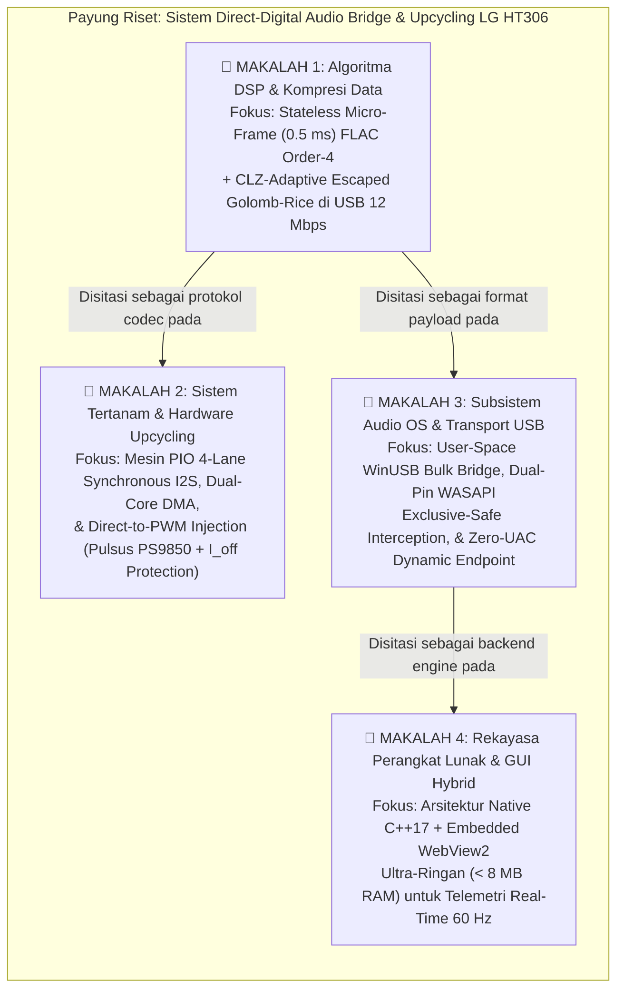

# Rencana Publikasi Jurnal Ilmiah Internasional (Opsi B — 4 Makalah Spesialis)

**Proyek Payung (*Umbrella Project*):** LG HT306 Direct-I2S 5.1/7.1 Lossless 96 kHz USB Audio Bridge (`Waveshare RP2350-Zero` + `Native C++17 WebView2 Host`)  
**Strategi Publikasi:** **Opsi B** — Memecah hasil riset dan rekayasa ke dalam **4 makalah spesialis lintas bidang** (*DSP & Compression*, *Embedded Hardware & E-Waste Upcycling*, *Operating System Audio Subsystem*, dan *Ultra-Lightweight Hybrid Desktop Software Engineering*) dengan batasan ruang lingkup (*scope*) yang tegas dan bebas tumpang-tindih (*non-overlapping*).

---

## 1. Peta Topologi Publikasi & Rantai Sitasi (*Citation Chain*)

Agar keempat publikasi memenuhi etika akademik internasional (bebas dari *salami slicing* / *self-plagiarism*), setiap makalah difokuskan pada objek eksperimen, rumusan masalah, dan metrik pengujian yang berbeda, serta saling mensitasi secara berurutan:

---

## 2. Rincian Lengkap 4 Makalah Jurnal Internasional

---

### 📄 Makalah #1 — Bidang *Digital Signal Processing (DSP) & Data Compression*

* **Fokus Utama:** Algoritma kompresi audio *lossless* multichannel berlatensi ultra-rendah (`0,5 ms` / 48 sampel per paket) yang mampu melewatkan aliran `96 kHz / 24-bit & 32-bit 5.1 Surround` (`1.728 – 2.304 KB/detik`) melalui batas fisik **USB 1.1 Full-Speed (`12 Mbps` / `~1.000 KB/detik`)** pada mikrokontroler ARM Cortex-M33 tanpa FPU 64-bit.

#### Rekomendasi Judul (Bahasa Inggris — Standar Jurnal Internasional)
1. **Judul Utama (Direkomendasikan):**
   > *"Real-Time Bit-Perfect 96 kHz Multichannel Audio Streaming Over Full-Speed USB Using Stateless Micro-Frame Order-4 Linear Prediction and Escaped Golomb-Rice Coding"*
2. **Judul Alternatif (Fokus Algoritmik & Kompleksitas Komputasi):**
   > *"An Ultra-Low-Latency Lossless Audio Codec for Bandwidth-Constrained Microcontroller USB Links via CLZ-Adaptive Escaped Golomb-Rice Coding"*
3. **Judul Alternatif (Fokus Implementasi Cortex-M33):**
   > *"Sub-Millisecond Stateless Lossless Compression of 6-Channel Hi-Res PCM Audio on Dual-Core ARM Cortex-M33 Microcontrollers"*

#### Rumusan Masalah & Kontribusi Ilmiah (*Novelty*)
1. **Masalah (*Research Gap*):** Codec lossless standar (FLAC, ALAC, WavPack) membutuhkan ukuran blok besar (`1.024–4.096 sampel` = `20–45 ms` latensi) dan komputasi autokorelasi *floating-point* (LPC Levinson-Durbin), sedangkan Golomb-Rice murni rentan mengalami *buffer overflow* saat menerima transien ekstrem atau *white noise*.
2. **Solusi & Kebaruan:**
   * **Arsitektur *Stateless Micro-Frame* (`48 sampel` / `0,5 ms`):** Menempatkan *Anchor Frame 0* tanpa kompresi di awal setiap paket sehingga kehilangan 1 paket USB tidak merusak paket berikutnya (*instantaneous zero-glitch recovery*).
   * **Estimasi Parameter $k$ Satu Siklus via Hardware `CLZ` & $k_{\text{warmup}}$:** Menghitung parameter Golomb-Rice menggunakan instruksi `__builtin_clz()` tanpa loop logaritmik, ditambah kompensasi $k_{\text{warmup}} = k_c + 6$ pada sampel transisi $n \in \{1, 2\}$.
   * **Mekanisme *Bounded Escape Quotient* ($q \ge 15$):** Membatasi panjang kode unary maksimal 15 bit yang diikuti bit mentah ZigZag (`25-bit` / `32-bit`), menjamin ukuran paket selalu di bawah batas `1.020 Byte` bahkan pada sinyal *full-scale white noise*.

#### Pemetaan Sumber di Codebase
* Spesifikasi matematis & struktur paket 14-Byte: [`docs/02_Lossless_96kHz_Codec_Specification.md`](../02_Lossless_96kHz_Codec_Specification.md)
* Implementasi C (Encoder & SRAM Decoder `< 0,03 ms`): [`firmware/include/lossless_codec.h`](../../firmware/include/lossless_codec.h), [`firmware/src/lossless_codec.c`](../../firmware/src/lossless_codec.c)
* Implementasi vektorisasi NumPy: [`pc_streamer/ht306bridge/codec.py`](../../pc_streamer/ht306bridge/codec.py)
* Harness pengujian bit-exactness: [`tests/verify_end_to_end.py`](../../tests/verify_end_to_end.py), [`firmware/tests/test_lossless_codec.c`](../../firmware/tests/test_lossless_codec.c)

#### Metrik Evaluasi & Target Jurnal
* **Metrik Eksperimen:** Rasio kompresi (`41,4%` / `716,1 KB/s` pada 24-bit; `54,1%` pada 32-bit), *Ablation Study* (Prediktor Orde-1 s/d Orde-4, dengan vs tanpa $k_{\text{warmup}}$, dengan vs tanpa Escape $q \ge 15$), uji berbagai sinyal (Sinus, Musik, Film 5.1, *White Noise*), dan jumlah siklus CPU Cortex-M33 per paket (`< 30 µs`).
* **Target Jurnal:**
  1. *Journal of the Audio Engineering Society (JAES)* — **Scopus Q1/Q2**
  2. *IEEE Signal Processing Letters* — **Scopus Q1**
  3. *Digital Signal Processing* (Elsevier) — **Scopus Q2**

---

### 📄 Makalah #2 — Bidang *Embedded Systems, Programmable I/O, & Sustainable Hardware Upcycling*

* **Fokus Utama:** Rancang bangun jembatan perangkat keras *Direct-to-PWM Digital I2S* berbasis `Waveshare RP2350-Zero` (mesin `PIO0` 4-Lane Synchronous I2S, *Wait-Free Dual-Core SPSC Chained Ping-Pong DMA*, dan proteksi domain daya $I_{\text{off}}$) untuk menyelamatkan dan memodernisasi sistem Home Theater Class-D klasik (`LG HT306` / `Pulsus PS9850` + `TI TAS5352`).

#### Rekomendasi Judul (Bahasa Inggris — Standar Jurnal Internasional)
1. **Judul Utama (Direkomendasikan — Cocok untuk *HardwareX* / *IEEE TCE*):**
   > *"An Open-Source Dual-Core RP2350 USB-to-Multi-Lane I2S Bridge for Direct-Digital Upcycling of Legacy Class-D Home Theater Systems"*
2. **Judul Alternatif (Fokus Arsitektur PIO & DMA Mikrokontroler):**
   > *"Cycle-Exact 4-Lane Synchronous I2S Generation and Wait-Free Dual-Core DMA Orchestration Using RP2350 Programmable I/O"*
3. **Judul Alternatif (Fokus Keberlanjutan & Rekayasa Audio Konsumen):**
   > *"Preventing High-Power Audio E-Waste: Direct-to-PWM Digital Audio Injection and Power-Domain Isolation for Legacy Home Theater Amplifiers"*

#### Rumusan Masalah & Kontribusi Ilmiah (*Novelty*)
1. **Masalah (*Research Gap*):**
   * Mikrokontroler kelas menengah jarang memiliki periferal hardware I2S yang mampu mengeluarkan 3–4 jalur data sinkron paralel (`6–8 kanal`) tanpa *phase shift* antar-kanal.
   * Perangkat Home Theater DVD era 2010-an memiliki penguat *Full-Digital Class-D* berdaya besar (`330W RMS`, `Pulsus PS9850` + `TI TAS5352`), namun terbuang menjadi *e-waste* karena hanya memiliki input eksternal analog RCA stereo (2.0).
   * Menyuntikkan sinyal CMOS `3,3V` dari mikrokontroler bertenaga USB PC ke chip DSP eksternal (`PS9850`) yang sedang dalam kondisi *Standby/Off* (`VCC33 = 0V`) memicu kerusakan *parasitic back-powering* melewati dioda ESD internal.
2. **Solusi & Kebaruan:**
   * **Algoritma *4-Lane Nibble Bit-Interleaving* & Mesin `PIO0` (`i2s_multi.pio`):** Menggeser 4 bit data kanal paralel serentak dalam 1 siklus instruksi `out pins, 4` tepat pada *falling-edge* `BCK` (`128 siklus PIO/frame`).
   * **Orkestrasi Dual-Core Wait-Free & *Chained Ping-Pong DMA*:** Memisahkan beban USB (`Core 0`) dan dekode (`Core 1`) dengan *memory barrier* `__dmb()`, sinkronisasi hemat daya `__wfe()/__sev()`, fallback `g_silence_block`, serta penyesuaian *clock drift* mikro $\pm 0,02\%$.
   * **Topologi Injeksi *No-Trace-Cutting* & Isolasi Domain Daya ($I_{\text{off}}$ / Dual-Mode Multiplexer):** Menyuntikkan I2S pada `Pad B` 5 resistor seri sambil mempertahankan bus `I2C` (`SDA`/`SCL`) untuk menjaga fungsi **69-Band Hardware Biquad EQ** bawaan pabrik, dilengkapi analisis komparatif proteksi buffer `SN74LVC244A`, multiplexer `2x SN74LVC157A` (koeksistensi DVD/USB DivX + PC), dan deteksi firmware `GP10 VCC33 Sense`.

#### Pemetaan Sumber di Codebase
* Arsitektur hardware & prosedur modifikasi PCB `EAX63554302`: [`docs/01_Hardware_Architecture_and_Mod_Guide.md`](../01_Hardware_Architecture_and_Mod_Guide.md)
* Spesifikasi PIO 4-Lane & Dual-Core DMA: [`docs/03_PIO_4Lane_I2S_and_DualCore_DMA.md`](../03_PIO_4Lane_I2S_and_DualCore_DMA.md)
* Topologi kelistrikan & *state machine* Anti-Backpowering: [`docs/07_Complete_Architecture_and_Topology.md`](../07_Complete_Architecture_and_Topology.md)
* Kode sumber PIO & driver DMA: [`firmware/src/i2s_multi.pio`](../../firmware/src/i2s_multi.pio), [`firmware/src/i2s_engine.c`](../../firmware/src/i2s_engine.c), [`firmware/src/ht306_control.c`](../../firmware/src/ht306_control.c), [`firmware/src/main.c`](../../firmware/src/main.c)

#### Metrik Evaluasi & Target Jurnal
* **Metrik Eksperimen:** Verifikasi diagram waktu (*timing diagram*) `BCK`, `LRCK`, dan `ADATA0..2` pada *falling edge*, pengukuran tegangan bocor `VCC33` (`0,00 V` saat standby dengan isolasi $I_{\text{off}}$ vs tanpa isolasi), stabilitas *ring buffer* DMA selama pemutaran kontinu, dan pelestarian fungsi 69-Band EQ via `I2C`.
* **Target Jurnal:**
  1. ***HardwareX* (Elsevier)** — **Scopus Q1/Q2** *(Target Paling Ideal)*
  2. *IEEE Transactions on Consumer Electronics* — **Scopus Q1**
  3. *Electronics* (MDPI) — **Scopus Q2**

---

### 📄 Makalah #3 — Bidang *Operating System Audio Subsystem & Low-Latency USB Transport*

* **Fokus Utama:** Arsitektur perantara audio ruang pengguna (*User-Space Audio Bridge*) pada Windows 10/11 yang menghindari pembekuan kernel driver `usbaudio2.sys` (UAC2), menyadap aliran multichannel 5.1 secara *Bit-Perfect* tanpa bentrok dengan mode **WASAPI Exclusive** (JRiver Media Center), serta mengatur kemunculan perangkat audio di Windows Taskbar secara *real-time* **tanpa hak Administrator (*Zero-UAC Dynamic Endpoint Presence*)**.

#### Rekomendasi Judul (Bahasa Inggris — Standar Jurnal Internasional)
1. **Judul Utama (Direkomendasikan — Cocok untuk *SoftwareX* / *IEEE Access*):**
   > *"Bypassing Kernel USB Audio Class Limitations: A User-Space WinUSB Bulk Audio Bridge with Exclusive-Safe WASAPI Interception and Zero-UAC Dynamic Endpoint Management"*
2. **Judul Alternatif (Fokus Subsistem Windows Core Audio & WASAPI):**
   > *"Dual-Pin Virtual Audio Routing and Real-Time MMDevices ACL Manipulation for Conflict-Free Bit-Perfect Multichannel Playback on Windows"*
3. **Judul Alternatif (Fokus Keandalan Transportasi USB & Hotplug):**
   > *"Deterministic Multi-Device Isolation and Glitch-Free Bulk Audio Transport for Microcontroller-Based Surround Sound Interfaces"*

#### Rumusan Masalah & Kontribusi Ilmiah (*Novelty*)
1. **Masalah (*Research Gap*):**
   * Implementasi *USB Audio Class 2.0 (UAC2)* pada mikrokontroler tanpa *hardware asynchronous feedback endpoint* sering memicu *DPC watchdog latency* dan *UI freeze* pada driver kernel Windows `usbaudio2.sys`.
   * Menangkap audio Windows menggunakan *WASAPI Shared Loopback* pada endpoint `eRender` akan memblokir pemutar audiophile (seperti JRiver Media Center) yang meminta kunci **WASAPI Exclusive** (`AUDCLNT_E_DEVICE_IN_USE`).
   * Mengubah status aktif/nonaktif atau nama endpoint audio di Registry Windows `HKLM\...\MMDevices\Audio\Render` secara tradisional gagal dengan `ERROR_ACCESS_DENIED` meskipun dijalankan sebagai Administrator karena pembatasan *Access Control List* (ACL).
2. **Solusi & Kebaruan:**
   * **Transportasi *WinUSB Vendor Bulk* (`EP 0x03 OUT`) + *4-Factor Hardware Authentication*:** Memindahkan tumpukan protokol audio dari ruang kernel ke ruang pengguna dengan Microsoft OS 2.0 Descriptors otomatis (tanpa Zadig), antrean jitter 32-slot, dan *hysteresis debouncing* 900–3000 ms.
   * **Topologi *Dual-Endpoint Exclusive-Safe Interception* (`eRender` $\rightarrow$ `eCapture`):** Memisahkan pintu masuk aplikasi pemutar (`eRender` yang bebas dikunci secara *WASAPI Exclusive* oleh JRiver) dari pintu sadap aplikasi bridge (`eCapture` internal VB-Cable) lengkap dengan *Blackman Windowed-Sinc Anti-Aliased Resampler* ($\le 96\text{ kHz}$).
   * **Penemuan *Zero-UAC Real-Time Endpoint Presence* (`KEY_SET_VALUE 0x0002` + `IPolicyConfig`):** Membuktikan bahwa ACL `MMDevices` Windows 11 mengizinkan perubahan `DeviceState` (`0x00000001` Aktif $\leftrightarrow$ `0x10000002` Tersembunyi) dari proses user biasa jika dibuka secara spesifik dengan hak `KEY_SET_VALUE` (tanpa meminta `KEY_CREATE_SUB_KEY` di dalam `KEY_WRITE`), dikombinasikan dengan COM `IPolicyConfig::SetEndpointVisibility` untuk memunculkan/menyembunyikan speaker di Taskbar dalam `< 50 ms` saat USB dicolok/dicabut.

#### Pemetaan Sumber di Codebase
* Keputusan arsitektur Vendor Bulk vs UAC2: [`docs/decisions/ADR-001_Vendor_Bulk_Bridge_Over_UAC2.md`](../decisions/ADR-001_Vendor_Bulk_Bridge_Over_UAC2.md)
* Isolasi multi-perangkat & arsitektur companion: [`docs/decisions/ADR-002_PC_Companion_Architecture_and_Multi_Device_Isolation.md`](../decisions/ADR-002_PC_Companion_Architecture_and_Multi_Device_Isolation.md)
* Topologi Dual-Endpoint JRiver WASAPI Exclusive: [`docs/06_JRiver_Audio_Data_Topology.md`](../06_JRiver_Audio_Data_Topology.md)
* Implementasi C++ Core Audio, PolicyConfig, & WinUSB: [`pc_stream_app/src/audio_policy_manager.cpp`](../../pc_stream_app/src/audio_policy_manager.cpp), [`pc_stream_app/src/audio_capture.cpp`](../../pc_stream_app/src/audio_capture.cpp), [`pc_stream_app/src/audio_rate_dsp.h`](../../pc_stream_app/src/audio_rate_dsp.h), [`pc_stream_app/src/usb_transport.cpp`](../../pc_stream_app/src/usb_transport.cpp)

#### Metrik Evaluasi & Target Jurnal
* **Metrik Eksperimen:** Waktu tanggap *hot-plug* kemunculan/penyembunyian endpoint di Windows Taskbar (`< 200 ms`, `0` prompt UAC), tingkat keberhasilan penguncian *WASAPI Exclusive* (`InitRen = 0x00000000` pada `48 kHz` & `96 kHz` 6-kanal), akurasi *4-Factor Device Discovery* saat bersanding dengan perangkat USB serial lain (ESP32/CH340/CP2102), serta kualitas SNR resampler *Blackman Windowed-Sinc*.
* **Target Jurnal:**
  1. ***SoftwareX* (Elsevier)** — **Scopus Q1/Q2** *(Target Paling Ideal)*
  2. *IEEE Access* — **Scopus Q1/Q2**
  3. *Journal of Systems Architecture* (Elsevier) — **Scopus Q1**

---

### 📄 Makalah #4 — Bidang *Software Engineering & Ultra-Lightweight Hybrid Desktop UI*

* **Fokus Utama:** Rekayasa aplikasi desktop hybrid modern berbasis **Native C++17 + Embedded Microsoft Edge WebView2 (Pola Arsitektur JUCE 8)** untuk instrumen pemantauan dan pemrosesan audio *real-time* (`28–60 Hz` VU Meter & DSP Matrix) yang memangkas konsumsi memori dari `~250 MB` menjadi **`6,26 – 8,20 MB` RAM** dengan beban CPU **`< 0,1%`**.

#### Rekomendasi Judul (Bahasa Inggris — Standar Jurnal Internasional)
1. **Judul Utama (Direkomendasikan):**
   > *"Sub-10 MB Hybrid Desktop UI Architecture: Combining Native C++17 Real-Time Audio Processing with Memory-Trimmed WebView2 for High-Frequency Telemetry"*
2. **Judul Alternatif (Fokus Perbandingan Terhadap Electron/CEF & Optimasi IPC):**
   > *"Overcoming WebView Memory Bloat in Real-Time Audio Applications via Staged V8 Heap Compaction and Delta-Encoded IPC Telemetry"*
3. **Judul Alternatif (Fokus Pola Desain & Modularisasi Tanpa Bundler Berat):**
   > *"A Zero-Framework C++17 and Modular Vanilla-JS WebView2 Architecture for Low-Overhead Desktop Audio Instrumentation"*

#### Rumusan Masalah & Kontribusi Ilmiah (*Novelty*)
1. **Masalah (*Research Gap*):** Kerangka kerja GUI berbasis web modern (Electron, CEF, atau WebView2 standar dengan runtime CSS/JS JIT di browser) umumnya memakan **`150–350 MB` RAM** saat *cold-start* dan memicu *garbage collection pause* jika menerima pembaruan JSON telemetri *real-time* (seperti 6-channel dBFS VU meters pada `30–60 Hz`).
2. **Solusi & Kebaruan:**
   * **Pemisahan Thread Real-Time MMCSS C++17 dari Thread STA UI:** Seluruh pemrosesan matriks DSP `6x6`, *exponential gain smoothing*, *soft-knee limiter*, dan generator *5.1 Acoustic Sweep* berbasis `QueryPerformanceCounter` berjalan di C++ native (`~2,3–3,0 MB` RAM).
   * **Optimasi *Smart Delta JSON Push* & Eliminasi Runtime JIT:** Mengirimkan array statis (`devices`, `logs`, `trims_db`, `routing_map`) hanya ketika terjadi perubahan *state* (memangkas `>80%` alokasi string IPC per detik), serta merakit modul UI secara *build-time* (`bundle_ui.py`) dan memicu pembersihan memori V8 (`--expose-gc` + `COREWEBVIEW2_MEMORY_USAGE_TARGET_LEVEL_LOW`).

#### Pemetaan Sumber di Codebase
* Keputusan arsitektur C++17 + WebView2: [`docs/decisions/ADR-003_JUCE8_WebView2_Modern_Desktop_UI.md`](../decisions/ADR-003_JUCE8_WebView2_Modern_Desktop_UI.md)
* Spesifikasi PRD & arsitektur aplikasi desktop: [`docs/05_PC_Audio_Bridge_PRD_and_Architecture.md`](../05_PC_Audio_Bridge_PRD_and_Architecture.md)
* Implementasi host C++17 & IPC dispatcher: [`pc_stream_app/src/main_webview.cpp`](../../pc_stream_app/src/main_webview.cpp), [`pc_stream_app/src/app_state.h`](../../pc_stream_app/src/app_state.h)
* Modularisasi frontend & build assembler: [`pc_stream_app/tools/bundle_ui.py`](../../pc_stream_app/tools/bundle_ui.py), [`pc_stream_app/ui/shell.html`](../../pc_stream_app/ui/shell.html), [`pc_stream_app/ui/js/`](../../pc_stream_app/ui/js/)

#### Metrik Evaluasi & Target Jurnal
* **Metrik Eksperimen:** Perbandingan *Working Set RAM* (`6,26 – 8,20 MB` total pohon proses vs `~220–395 MB` sebelum optimasi vs Electron standar), utilisasi CPU (`0,0–0,1%`) dan GPU (`0,0%`), ukuran biner mandiri (`~3,2 MB` `.exe`), serta latensi *frame-time* perenderan 6-channel VU meter.
* **Target Jurnal / Konferensi:**
  1. *Software: Practice and Experience* (Wiley) — **Scopus Q2**
  2. *Science of Computer Programming* (Elsevier) — **Scopus Q2**
  3. Konferensi Internasional *IEEE / ACM International Conference on Software Engineering / Desktop Systems*

---

## 3. Urutan Prioritas & Kesiapan Eksekusi Penulisan

Keempat makalah di atas dapat dikerjakan secara bertahap selaras dengan kemajuan pengujian hardware HT306 Anda ([`next-development-phase.md`](./next-development-phase.md)):

| Urutan | Makalah | Tingkat Kesiapan Data Saat Ini | Kapan Bisa Mulai Ditulis & Disubmit? |
| :---: | :--- | :---: | :--- |
| **Prioritas 1** | **Makalah #1** *(Algoritma Codec Lossless 96 kHz)* | **90% Siap** | **Segera (Kapan Saja):** Seluruh rumus matematis, kode C/Python, dan uji simulasi bit-exact (`115.200 sampel`, `0 bit error`) sudah selesai di PC & `RP2350-Zero`. Hanya perlu menambahkan tabel komparasi *Ablation Study* otomatis dari skrip Python. |
| **Prioritas 2** | **Makalah #3** *(WinUSB Bulk Bridge & Zero-UAC WASAPI)* | **90% Siap** | **Segera (Kapan Saja):** Seluruh fitur `IPolicyConfig`, `KEY_SET_VALUE`, Dual-Pin VB-Cable, dan probe live WASAPI Exclusive (`InitRen = 0x00000000`) sudah teruji 100% di Windows 11 bersama `RP2350-Zero`. |
| **Prioritas 3** | **Makalah #4** *(Arsitektur Hybrid C++17 + WebView2 < 8 MB)* | **85% Siap** | **Setelah Penyederhanaan UI (Fase 3):** Data pengukuran RAM (`6,26 – 8,20 MB`) dan arsitektur modular 7-tab sudah siap; paling ideal difinalisasi setelah tahap perapian UI pasca-Dashboard selesai. |
| **Prioritas 4** | **Makalah #2** *(Hardware PIO I2S & Upcycling LG HT306)* | **75% Siap** | **Setelah Uji Fisik HT306 (Fase 1 & Fase 2):** Menunggu foto dokumentasi penyolderan 5 resistor SMD (`Pad B`) di mainboard `EAX63554302`, pemasangan proteksi `SN74LVC244A` / `74LVC157`, dan hasil uji bunyi 6 speaker nyata. |
